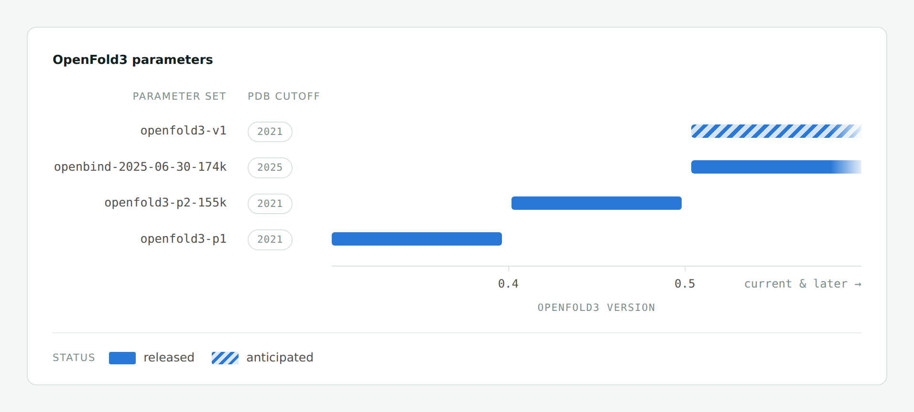

# TurboPairFormer for OpenFold3

## Install TurboPairFormer

PyPI publication is pending. The tested 0.1.0 candidate wheel is bundled in
this repository, which currently requires repository access. From a checkout,
install it into a dedicated environment with the command below. After the
PyPI upload, `pip install TurboPairFormer` will be available directly.

The standalone package provides Triangle Attention and Triangle Multiplicative
Update without requiring an OpenFold3 installation:

```bash
python3.14 -m venv .venv-turbopairformer
source .venv-turbopairformer/bin/activate
python -m pip install release_artifacts/turbopairformer/0.1.0/turbopairformer-0.1.0-cp314-cp314-manylinux_2_28_x86_64.whl
```

```python
from turbopairformer import triangle_attention, run_trimul

output = triangle_attention(q, k, v, mask, pair_bias)
```

For the complete OpenFold3 environment, create a separate checkout:

```bash
git clone --branch feat/turbopairformer-pip-package --single-branch \
  https://github.com/RyanAIResearch/openfold3_triangle_kernel.git openfold3-turbopairformer
cd openfold3-turbopairformer
pixi install -e openfold3-cuda12
pixi run -e openfold3-cuda12 doctor-turbopairformer
```

The virtual environment and the new checkout's `.pixi/envs/openfold3-cuda12`
keep these dependencies separate from existing training environments.

Both installation paths use the same bundled **TurboPairFormer 0.1.0** wheel and
**PyPI Torch 2.10.0 / CUDA runtime 12.8**. The target is Linux x86-64 with
glibc 2.28 or newer, CPython 3.14, and Hopper compute capability 9.0
(H100/H200). Installing the prebuilt kernels requires no nvcc.

Pixi installs this checkout's OpenFold3 host non-editably and selects
`OPENFOLD3_TRIANGLE_PROVIDER=turbopairformer` for commands in
`openfold3-cuda12`. Installing the standalone pip package alone does not change
provider selection in an existing OpenFold3 environment. The host integration
supports single-GPU launches; multi-GPU package integration is not yet qualified.
See the [installation and training guide](docs/source/turbopairformer_pip_quickstart.md)
and [standalone API examples](packages/turbopairformer/README.md).

Development continues on `feat/turbopairformer-pip-package`.
[`main`](https://github.com/RyanAIResearch/openfold3_triangle_kernel/tree/main)
remains the production code line. CUDA source and internal `stablefold_*`
symbols retain their identity. Historical results below belong to their
recorded in-tree artifacts and hardware; they are not performance measurements
of the new package or H200 measurements.

## Existing main production workflow (StableFold)

The following production instructions and measurements describe the existing
`main` implementation and its historical artifacts. Their StableFold names,
configuration flags, and binary identities are preserved. On this branch, that historical runtime is available as
`openfold3-cuda12-intree`. It has its own Conda Torch / CUDA 12.9 ABI.
The TurboPairFormer environment above uses a separate package and runtime.

StableFold is a Hopper-optimized Triangle Attention and Triangle
Multiplicative Update backend integrated directly into OpenFold3. It keeps the
OpenFold3 training entry points, datasets, checkpoints, and configuration
structure unchanged; users select the backend through the model configuration.

The central optimization is a single-reconstruction Triangle Attention
backward. A flash-style two-pass implementation reconstructs the attention
probabilities and score gradients once for `dK/dV` and again for `dQ/dBias`.
StableFold reconstructs each tile once and immediately uses it for all four
gradients. A fixed-order `dBias` reduction replaces floating-point atomics, and
an optional forward rounding residual improves the row-scalar used by the
backward without changing the public BF16 output.

## Parameters available in OpenFold3



Each parameter set is compatible with a specific range of OpenFold3 releases. See [OpenFold3 Parameters](https://openfold-3.readthedocs.io/en/latest/parameters_reference.html) in our documentation for checkpoint file names and details on how parameters are resolved at inference time.

### OpenBind-0
The default parameters shipped with OpenFold3 `>=0.5.0` are [OpenBind-0](https://openbind.uk/news/blog-openbind-0-advancing-open-molecular-structure-prediction/), which is trained using the forthcoming OpenFold3 architecture with a June 2025 training cutoff. See the [announcement blog post](https://openbind.uk/news/blog-openbind-0-advancing-open-molecular-structure-prediction/) for benchmarks and details. We reccomend using the OpenBind-0 model over OpenFold3-preview2 for everyday usage.

If you want to keep using the OpenFold3-preview2 weights, install an older release of OpenFold3 - see [how do I use an older set of parameters](https://openfold-3.readthedocs.io/en/latest/parameters_reference.html#how-do-i-use-an-older-set-of-parameters) in our documentation.

## Technical report
A technical description of the OpenFold3-preview2 model version is available [here](https://portal.openfold.omsf.io/reports/of3p2_technical_report.pdf). Note that the OpenFold3-preview2 weights require an [older release](https://openfold-3.readthedocs.io/en/latest/parameters_reference.html#how-do-i-use-an-older-set-of-parameters) of OpenFold3.

## Requirements

- Linux x86-64
- NVIDIA H100 80 GB, compute capability 9.0 (`sm_90a`)
- CPython 3.14
- PyTorch 2.10.0 built for CUDA 12.9
- NVIDIA driver compatible with the locked CUDA 12.9 runtime; users do not need NVCC
- BF16 Q/K/V; BF16 or FP32 pair bias; FP16, BF16, or FP32 additive mask

The prebuilt Triangle Attention extensions contain Hopper-specific SASS and no
PTX fallback. An ABI or device mismatch is an error, not a reason to load the
binary anyway.

## Upstream synchronization

The source tree includes AQLab `main` through
[`7de748b7`](https://github.com/aqlaboratory/openfold-3/commit/7de748b7bc93adb5af0a4032d5e9f208b6e1325f)
(2026-09-18), including template-server reliability, inference intermediate
management, and memory-efficient metrics updates. See [`UPSTREAM.md`](UPSTREAM.md).
The production environment below still installs the separately qualified
`87ebe22da` wheel. Updating this checkout does not rebuild that wheel or claim
GPU qualification of the newly merged host code.

## Pixi production workflow

To reproduce the historical in-tree workflow from this branch, use a clean checkout:

```bash
mkdir -p /mnt/shared/openfold3
git clone --branch feat/turbopairformer-pip-package --single-branch \
  https://github.com/RyanAIResearch/openfold3_triangle_kernel.git \
  /mnt/shared/openfold3/src
cd /mnt/shared/openfold3/src
git rev-parse HEAD
test -z "$(git status --porcelain=v1)"
```

Create the locked, non-editable H100 environment and install the qualified
wheel already stored in the repository; no kernel build command is required:

Run the two installation commands once for either one GPU or multiple GPUs on
one host. For multiple hosts, run them once on node 0 only when the checkout
and `.pixi` prefix are on the same shared filesystem; with node-local storage,
run them independently on every host because Pixi does not synchronize nodes.

```bash
curl -fsSL https://pixi.sh/install.sh | sh
export PATH="$HOME/.pixi/bin:$PATH"
pixi install -e openfold3-cuda12-intree
pixi run -e openfold3-cuda12-intree doctor-h100
pixi run -e openfold3-cuda12-intree verify-aot
```

The production Pixi environment deliberately contains no editable OpenFold3
dependency. `pixi install` installs the repository-pinned wheel directly from
the committed lockfile without compiling any StableFold source, while every
training task checks
that the installed package, artifact commit, ABI, embedded manifest, wheel
RECORD, and five extension hashes still match before launching outside the
source checkout. Dependencies may probe the Pixi-provided compiler ABI and
CUDA version, but the task does not invoke a StableFold kernel build, CMake,
Ninja, or JIT. It then directly executes AQLab `run_openfold` or standard
`torchrun` without replacing training, strategy, checkpoint, logging, or loss
behavior, and the selector changes only the training kernel-route flags.

The integration checkout and the binary artifact intentionally have separate
identities: the checkout contains the installer and guide, while the
wheel records the qualified source commit `87ebe22da13c657d36997dedb4ec398fbd62c6b7`.
That wheel keeps Diffusion on AQLab's original attention path and runs
StableFold only for non-Diffusion triangle Attention and TMU outside the source
checkout. Its single-node DDP path has been exercised on two real H100s through
scratch training, validation, checkpointing, and resume. Eight-H100 and real
multi-node qualification remain pending hardware.

For a copy-and-run bare-metal path covering clone, data, prebuilt installation,
backend selection, single-GPU training, single-node DDP, and multi-node launch,
see the
[Bare-metal training quickstart](docs/source/bare_metal_distributed_quickstart.md).

## Enable StableFold manually

Set the SR-R backward contract before starting Python:

```bash
export OPENFOLD3_SR_BACKWARD=1
export OPENFOLD3_SR_SHADOW=1
export OPENFOLD3_TRIANGLE_ALLOW_JIT=0
```

`OPENFOLD3_SR_SHADOW=1` stores a BF16 rounding residual in the forward and uses
it only to improve the backward row scalar. It does not change the model-visible
forward output.

In a training YAML, select the backend under the train memory settings:

```yaml
model_update:
  custom:
    settings:
      memory:
        train:
          use_stable_triangle_attention: true
          use_stable_triangle_multiplicative: true
          use_cueq_triangle_kernels: false
          use_triton_triangle_kernels: false
          use_deepspeed_evo_attention: false
          use_lma: false
          chunk_size: null
```

Keep the existing OpenFold3 architecture defaults when using StableFold
Triangle Multiplicative Update: every relevant MSA, Pairformer, and template
stack must retain `fuse_projection_weights: false`. Everything else in the
existing OpenFold3 training command can remain unchanged.

For an Attention-only compiler-free canary, replace the corresponding values
in the same `memory.train` block:

```yaml
model_update:
  custom:
    settings:
      memory:
        train:
          use_stable_triangle_attention: true
          use_stable_triangle_multiplicative: false
          use_cueq_triangle_kernels: false
          use_triton_triangle_kernels: false
          use_deepspeed_evo_attention: false
          use_lma: false
          chunk_size: null
```

## 4. Verify before training

Run the packaging and routing tests:

```bash
python -m unittest \
  openfold3.tests.core.kernels.test_stablefold_triangle_aot_packaging \
  openfold3.tests.core.kernels.test_stablefold_triangle_packaging \
  openfold3.tests.core.kernels.test_stablefold_triangle_workspace \
  openfold3.tests.core.model.test_attention_stable_routing
```

Run one public-facade forward/backward smoke:

```bash
python scripts/benchmarks/stablefold_triangle_sanitizer_smoke.py \
  --sequence 65 --heads 4 --head-dim 32 --prefix 1
```

Before trusting performance, run a short paired canary with the same checkpoint,
data order, precision, crop, and logging configuration as the comparator. Check:

- finite loss and gradients;
- expected StableFold route counts and no silent fallback;
- no JIT/rebuild of the four Triangle Attention extensions or the fifth TriMul
  extension;
- peak memory and OOM headroom on the largest real sample;
- synchronized training-step time after warmup;
- checkpoint save/resume and validation.

## 5. Roll back

No code change is required to return to cuEquivariance:

```yaml
use_stable_triangle_attention: false
use_stable_triangle_multiplicative: false
use_cueq_triangle_kernels: true
```

```bash
unset OPENFOLD3_SR_BACKWARD
unset OPENFOLD3_SR_SHADOW
```

Unsupported StableFold Attention shapes are explicitly routed to the stock
OpenFold3 implementation; the public StableFold facade itself fails closed.
Monitor fallback counts rather than assuming every call used the custom kernel.

StableFold TriMul uses a fixed, non-configurable short-sequence boundary:
valid TriMul calls with `N <= 100` are metadata-unsupported by the AOT path and
the model selector routes them directly to stock PyTorch. The H100 BF16 AOT
path starts at `N = 101` for `C_z = C_hidden` in `{32, 64, 96, 128}`. The
boundary value matches cuEquivariance 0.10's
`CUEQ_TRIMUL_FALLBACK_THRESHOLD=100`, but StableFold does not read that or any
other environment variable. Unsupported direct-facade calls remain
fail-closed; only the model selector owns the stock fallback.

## Supported scope and claim boundaries

- Main measured crops: 384, 640, and 768
- Main measured head dimensions: 16, 24, 32, and 48 across real OpenFold3 sites
- Runtime Triangle Attention contract: positive prefixes, runtime sequence
  length/head count, and `1 <= D <= 64`, subject to CUDA grid and memory limits
- Determinism means bitwise self-replay with the same backend, inputs, software
  ABI, workspace plan, and hardware; it does not mean cross-backend or
  cross-hardware bit equality
- The rounding residual corrects the backward row-scalar channel only; it does
  not eliminate every BF16 error
- The speedup comes from single reconstruction; the fixed reduction tree and
  rounding residual each have a cost
- Do not infer convergence superiority or memory savings from the timing result

The detailed kernel contract is in
[`PRODUCTION_MANIFEST.md`](openfold3/core/kernels/cuda/PRODUCTION_MANIFEST.md).
Experimental protocols and receipts are documented under
[`scripts/benchmarks/sr/`](scripts/benchmarks/sr/) and [`paper/`](paper/).

## Direct operator entry point

Users integrating below the OpenFold3 model router can call:

```python
from openfold3.core.kernels.cuda.stablefold_triangle_attention import (
    stablefold_triangle_attention,
)

output = stablefold_triangle_attention(q, k, v, mask, pair_bias)
```

Use the public facade rather than importing private extension symbols. The facade
validates the tensor/device contract and supplies PyTorch autograd integration.

## License and attribution

This repository is derived from
[AQLab OpenFold3](https://github.com/aqlaboratory/openfold-3) and is distributed
under Apache-2.0. Retain [`LICENSE`](LICENSE), [`NOTICE`](NOTICE),
[`UPSTREAM.md`](UPSTREAM.md), and [`CITATION.cff`](CITATION.cff) when sharing an
internal source or binary bundle.
