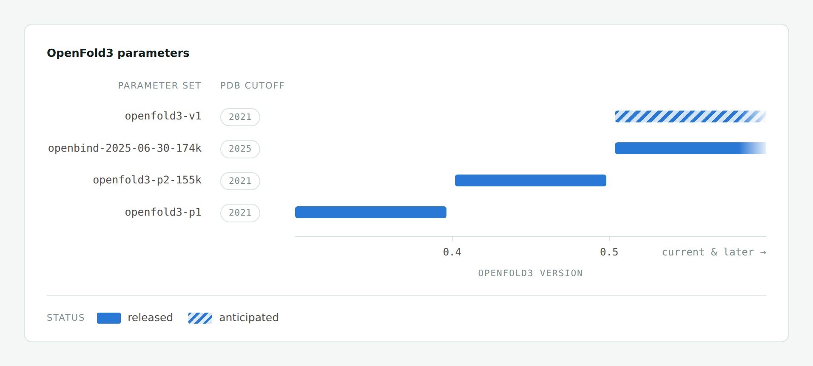

# TurboPairFormer for OpenFold3

TurboPairFormer is a Hopper-optimized Triangle Attention and Triangle
Multiplicative Update backend integrated directly into OpenFold3. It keeps the
OpenFold3 training entry points, datasets, checkpoints, and configuration
structure unchanged; users select the backend through the model configuration.

The two operators are **TurboTriangleAttention** (Triangle Attention) and
**TurboTriangleMultiplicative** (Triangle Multiplicative Update).

The integrated backend is selected with `--backend turbopairformer`. Current
module names, extension identities, artifact paths and kernel receipts use the
TurboPairFormer name.

The current implementation lives in `openfold3/core/kernels/turbopairformer/`.
Direct source imports use `openfold3.core.kernels.turbopairformer` in place of
`openfold3.core.kernels.cuda`; function names and CUDA computations are unchanged.
AOT wheels built from this source use the new package path and must be rebuilt
and verified together with the Python package. The pinned September 18 wheel
retains its original namespace and validation receipts.

There is no compatibility alias for the old import path. Direct callers should
update imports, for example:

```python
from openfold3.core.kernels.turbopairformer.turbopairformer_triangle_attention import (
    turbopairformer_triangle_attention,
)
```

The `--backend turbopairformer` selector and training YAML keys are unchanged.
The [kernel tutorial](../openfold3/core/kernels/turbopairformer/tutorial.md) explains
the current implementation.

This `main` branch provides the integrated OpenFold3 production workflow. The
standalone **TurboPairFormer 0.1.0** Python package is available on
[PyPI](https://pypi.org/project/turbopairformer/0.1.0/). Package development and
its OpenFold3 integration live on
[`feat/turbopairformer-pip-package`](https://github.com/RyanAIResearch/openfold3_triangle_kernel/tree/feat/turbopairformer-pip-package).

The central optimization is a single-reconstruction Triangle Attention
backward. A flash-style two-pass implementation reconstructs the attention
probabilities and score gradients once for `dK/dV` and again for `dQ/dBias`.
TurboPairFormer reconstructs each tile once and immediately uses it for all four
gradients. A fixed-order `dBias` reduction replaces floating-point atomics, and
a forward rounding residual, enabled by default, improves the row scalar used
by the backward without changing the public BF16 output.

## Parameters available in OpenFold3



Each parameter set is compatible with a specific range of OpenFold3 releases. See [OpenFold3 Parameters](https://openfold-3.readthedocs.io/en/latest/parameters_reference.html) in our documentation for checkpoint file names and details on how parameters are resolved at inference time.

### OpenBind-0
The default parameters shipped with OpenFold3 `>=0.5.0` are [OpenBind-0](https://openbind.uk/news/blog-openbind-0-advancing-open-molecular-structure-prediction/), which is trained using the forthcoming OpenFold3 architecture with a June 2025 training cutoff. See the [announcement blog post](https://openbind.uk/news/blog-openbind-0-advancing-open-molecular-structure-prediction/) for benchmarks and details. We reccomend using the OpenBind-0 model over OpenFold3-preview2 for everyday usage.

If you want to keep using the OpenFold3-preview2 weights, install an older release of OpenFold3 - see [how do I use an older set of parameters](https://openfold-3.readthedocs.io/en/latest/parameters_reference.html#how-do-i-use-an-older-set-of-parameters) in our documentation.

## Technical report
A technical description of the OpenFold3-preview2 model version is available [here](https://portal.openfold.omsf.io/reports/of3p2_technical_report.pdf). Note that the OpenFold3-preview2 weights require an [older release](https://openfold-3.readthedocs.io/en/latest/parameters_reference.html#how-do-i-use-an-older-set-of-parameters) of OpenFold3.

## Requirements

- Linux x86-64
- NVIDIA H100 or H200, compute capability 9.0 (`sm_90a`); H100 validated,
  H200 enabled in the source runtime with device validation pending
- CPython 3.14
- PyTorch 2.10.0 built for CUDA 12.9
- NVIDIA driver compatible with the locked CUDA 12.9 runtime; users do not need NVCC
- For the existing BF16 path: BF16 Q/K/V; BF16 or FP32 pair bias;
  FP16, BF16, or FP32 additive mask. Native FP32 inference is described below.

The prebuilt Triangle Attention extensions contain Hopper-specific SASS and no
PTX fallback. An ABI or device mismatch is an error, not a reason to load the
binary anyway.

The source runtime accepts H100 and H200 for both Triangle Attention and TriMul.
The pinned Pixi wheel below remains the separately validated H100 artifact; this
source change does not rebuild or replace that installed runtime. H200 timing
and numerical results have not yet been measured.

## Upstream synchronization

The source tree includes AQLab `main` through
[`7de748b7`](https://github.com/aqlaboratory/openfold-3/commit/7de748b7bc93adb5af0a4032d5e9f208b6e1325f)
(2026-09-18), including template-server reliability, inference intermediate
management, and memory-efficient metrics updates. See [`UPSTREAM.md`](../UPSTREAM.md).
The production environment uses a separately built, pinned binary. Source
updates and namespace changes require their own artifact verification; the
qualification of an earlier binary does not transfer to a renamed build.

## Pixi production workflow

Clone the current `main` branch into a clean checkout:

```bash
mkdir -p /mnt/shared/openfold3
git clone --branch main --single-branch \
  https://github.com/RyanAIResearch/openfold3_triangle_kernel.git \
  /mnt/shared/openfold3/src
cd /mnt/shared/openfold3/src
git rev-parse HEAD
test -z "$(git status --porcelain=v1)"
```

Create the locked, non-editable H100 environment and install its pinned wheel;
users do not need a local kernel build command:

Run the two installation commands once for either one GPU or multiple GPUs on
one host. For multiple hosts, run them once on node 0 only when the checkout
and `.pixi` prefix are on the same shared filesystem; with node-local storage,
run them independently on every host because Pixi does not synchronize nodes.

```bash
curl -fsSL https://pixi.sh/install.sh | sh
export PATH="$HOME/.pixi/bin:$PATH"
pixi install -e openfold3-cuda12
pixi run -e openfold3-cuda12 doctor-hopper
pixi run -e openfold3-cuda12 verify-aot
```

`doctor-hopper` checks H100/H200 hardware and the locked runtime prerequisites;
`doctor-h100` remains an alias. Passing this preflight does not qualify an
installed wheel on H200.

The production Pixi environment deliberately contains no editable OpenFold3
dependency. `pixi install` installs the repository-pinned wheel directly from
the committed lockfile without compiling any TurboPairFormer source, while every
training task checks
that the installed package, artifact commit, ABI, embedded manifest, wheel
RECORD, and five extension hashes still match before launching outside the
source checkout. Dependencies may probe the Pixi-provided compiler ABI and
CUDA version, but the task does not invoke a TurboPairFormer kernel build, CMake,
Ninja, or JIT. It then directly executes AQLab `run_openfold` or standard
`torchrun` without replacing training, strategy, checkpoint, logging, or loss
behavior, and the selector changes only the training kernel-route flags.

The integration checkout and binary artifact have separate identities. The
installed wheel records its build source and extension hashes; the installer
verifies them before launch. Current release artifacts are stored under
`release_artifacts/turbopairformer-h100-20260918/`.

The renamed binary requires its own H100 execution validation. Consult the
artifact's accompanying validation report for completed checks. Full training,
checkpoint/resume and multi-GPU DDP qualification of this renamed artifact are
pending; historical results are not certification of the current binary.

For a copy-and-run bare-metal path covering clone, data, prebuilt installation,
backend selection, single-GPU training, single-node DDP, and multi-node launch,
see the
[Bare-metal training quickstart](../docs/source/bare_metal_distributed_quickstart.md).

## Protenix Attention + cuEq TriMul

The optional `protenix` training backend uses ByteDance's native Protenix
Triangle Attention with NVIDIA cuEquivariance 0.10.0 Triangle Multiplicative
Update. It is disabled by default and uses the Protenix revision from our
384/640/768 experiments. See [installation, scope and constraints](../docs/source/protenix_backend.md).

```bash
python tools/select_training_backend.py your_training.yml \
  --backend protenix --output training_protenix.yml
```

The generated YAML keeps your data, model weights, optimizer and training
schedule. It selects Protenix for BF16 triangle attention in the template,
MSA and main Pairformer stacks, and cuEq TriMul in the MSA and main Pairformer
stacks. Confidence, template TriMul and other attention retain their stock
routes. Protenix kernels are loaded lazily; the full Protenix model package is
not required.

## Enable TurboPairFormer manually

The current source's public facade always uses single-reconstruction backward.
`OPENFOLD3_SR_BACKWARD` defaults to `1`; explicitly setting it to `0` raises an
error. `OPENFOLD3_SR_SHADOW` also defaults to `1`. Setting shadow to `0` keeps
single reconstruction and is available for local accuracy ablations; DDP
requires shadow to remain enabled.

Keep these compatibility exports when using the pinned September 18 wheel,
which has not been rebuilt for this source change:

```bash
export OPENFOLD3_SR_BACKWARD=1
export OPENFOLD3_SR_SHADOW=1
export OPENFOLD3_TRIANGLE_ALLOW_JIT=0
```

The shadow path stores a BF16 rounding residual in the forward and uses it only
to improve the backward row scalar. It does not change the model-visible forward
output.

In a training YAML, select the backend under the train memory settings:

```yaml
model_update:
  custom:
    settings:
      memory:
        train:
          use_stable_triangle_attention: true
          use_stable_triangle_multiplicative: true
          use_cueq_triangle_kernels: false
          use_triton_triangle_kernels: false
          use_deepspeed_evo_attention: false
          use_lma: false
          chunk_size: null
```

Keep the existing OpenFold3 architecture defaults when using TurboPairFormer
Triangle Multiplicative Update: every relevant MSA, Pairformer, and template
stack must retain `fuse_projection_weights: false`. Everything else in the
existing OpenFold3 training command can remain unchanged.

For an Attention-only compiler-free canary, replace the corresponding values
in the same `memory.train` block:

```yaml
model_update:
  custom:
    settings:
      memory:
        train:
          use_stable_triangle_attention: true
          use_stable_triangle_multiplicative: false
          use_cueq_triangle_kernels: false
          use_triton_triangle_kernels: false
          use_deepspeed_evo_attention: false
          use_lma: false
          chunk_size: null
```

### Inference with automatic chunking

The current source integration supports the official prediction preset's
`chunk_size: 1024` and `tune_chunk_size: true` with Turbo attention. Select the
backend under `memory.eval`, keeping the prediction preset's other settings:

```yaml
model_update:
  presets: [predict]
  custom:
    settings:
      memory:
        eval:
          use_stable_triangle_attention: true
          use_stable_triangle_multiplicative: true
          use_cueq_triangle_kernels: false
          use_triton_triangle_kernels: false
          use_deepspeed_evo_attention: false
          use_protenix_triangle_attention: false
          use_lma: false
          chunk_size: 1024
          tune_chunk_size: true
```

The existing tuner probes a representative module and chooses a viable chunk
size up to the configured maximum. Changing the selected backend invalidates
the tuning cache. Triangle attention splits independent outer rows while
retaining the full key sequence, pair bias and matching masks. For example,
1280 rows with a chunk size of 1024 execute as 1024 and 256 rows; both chunks
still attend over all 1280 keys. Turbo also retains this chunking when the
confidence head processes multiple diffusion candidates together. This outer-row
chunking is inference-only: the module must be in `eval()` mode, gradients must
be disabled, and the call must be outside activation checkpointing. Training
retains the dense Turbo attention route; an explicit training chunk request
raises rather than silently changing BF16 gradient accumulation.

The current source adds inference-only FP32 implementations for both selected
operators. Automatic model dispatch requires `eval()` together with
`32-true` and `torch.no_grad()` / `torch.inference_mode()`. In that mode,
attention preserves FP32 Q/K/V, mask, pair bias, probabilities and output;
Triangle Multiplication preserves FP32 activations, projections, contractions
and output. Neither implementation converts these values to BF16 or calls the
stock/cuEq operator as a fallback. Unsupported CUDA requests selected for this
FP32 inference path raise explicitly. The model's TriMul selector
preserves its CPU compatibility fallback; the direct native FP32 APIs require
CUDA. The established BF16 training kernels and backward remain in use for
training. The repository checkpoint wrapper also keeps the training route for
both the initial forward and recomputation, including nested projections. An
eval-mode checkpoint entry with gradient-requiring inputs stays on that route.
External `torch.utils.checkpoint` wrappers around an arbitrary eval-mode model
cannot always be detected once intermediate tensors lose their autograd state;
use the repository checkpoint wrapper, or keep the model in training mode when
checkpointing. Direct native FP32 APIs remain inference-only and require a
no-grad context. At model dispatch, CUDA autocast requesting BF16 or FP16 retains the
existing mixed-precision route. The new FP32 route accepts both disabled
autocast and enabled FP32 autocast, including the confidence head's FP32
context. Calling a native FP32 API directly intentionally disables autocast
inside that API.

With TF32 enabled, FP32 attention fuses QK, online softmax and PV in one CUDA
kernel. Scores and probabilities stay on chip and the kernel writes the public
output layout directly. QK uses three TF32 products (leading and two cross
terms) to reduce rounding error; PV uses a single TF32 product. Operands use
explicit round-to-nearest-even conversion, with FP32 accumulators and stored
tensors. This forward expansion is distinct from the BF16 backward shadow
correction and must not be labelled “all precision compensation off.”

For C and hidden widths in {32, 64, 96, 128}, TF32 Triangle Multiplication
normalizes each input row once per projection chunk and reuses the rounded
FP32 scratch across its five projections. The following kernel fuses projections,
gates and layout packing. Fused
gates use FP32 approximate exponential/division, checked against the unchanged
numerical error bounds. Its output kernel fuses normalization, projection and gating directly from the
contraction layout. The complete-N contraction still uses vendor batched GEMM.
Other channel widths and TF32-disabled calls retain the native FP32 vendor
composition. TF32-disabled attention uses bounded cuBLAS PEDANTIC QK/PV and
native CUDA softmax. Neither implementation calls stock/cuEq as a fallback.

Both paths honor `torch.backends.cuda.matmul.allow_tf32`, with
`NVIDIA_TF32_OVERRIDE=0` taking precedence. They disable autocast locally and
never modify global precision flags. Allowing TF32 changes internal arithmetic,
not tensor storage dtype. Strict FP32 and TF32 are separate performance modes.

Attention's 64 MiB score/output scratch budget applies to the strict FP32
path; fused TF32 attention does not allocate those global tiles. TriMul input
projection chunk sizing uses a 128 MiB budget. Contraction uses a separate
512 MiB FP32 product-scratch budget and selects the output-row count from the
sequence length and hidden width, always retaining the complete reduction axis.
The direct API can instead set an explicit output-row count. The TF32 input path additionally
holds one normalized FP32 chunk, preserving the existing chunk boundaries:
up to 21.33 MiB for C=H=128, at most 42.67 MiB over the supported widths. It avoids
materializing the five projection outputs separately. Budgets exclude returned outputs, input
layout copies, persistent A/B/gate tensors and vendor-library workspace.
The model's automatic outer-row chunking still applies.

The explicit Turbo TriMul selector also reaches the confidence head during
CUDA FP32 inference with gradients disabled. It preserves the existing batched
and per-sample confidence modes. Training and callers using BF16/FP16 autocast
retain the previous confidence TriMul route.

These new extensions require rebuilding from the current source; previously
published `0.1.3.post1` binaries do not contain them. This implementation adds
precision support and does not by itself establish a speedup or structure
quality equivalence. MSA/template inference-offload restrictions remain.

Run the host integration tests and, on Hopper, the real-kernel checks with:

```bash
python -m pytest openfold3/tests/test_turbopairformer_chunking.py \
  openfold3/tests/test_turbopairformer_fp32_inference.py -q
```

## 4. Verify before training

Run the packaging and routing tests:

```bash
python -m unittest \
  openfold3.tests.core.kernels.test_turbopairformer_triangle_aot_packaging \
  openfold3.tests.core.kernels.test_turbopairformer_triangle_packaging \
  openfold3.tests.core.kernels.test_turbopairformer_triangle_workspace \
  openfold3.tests.core.model.test_attention_stable_routing
```

Run one public-facade forward/backward smoke:

```bash
python scripts/benchmarks/turbopairformer_triangle_sanitizer_smoke.py \
  --sequence 65 --heads 4 --head-dim 32 --prefix 1
```

For the current source checkout on Hopper, run the SR routing and FP64 checks
in the source-development environment:

```bash
pixi run -e openfold3-cuda12-dev env OPENFOLD3_TRIANGLE_ALLOW_JIT=1 \
  python -m pytest openfold3/tests/core/kernels/test_turbopairformer_sr_policy.py
```

`tools/aot_numeric_smoke.py` remains the frozen, hash-qualified validator for the
pinned wheel. Its classic cases and the `OPENFOLD3_SR_BACKWARD=0` comparison arms
in `scripts/benchmarks/sr/` require their recorded historical runtime. The
current source's public facade rejects those legacy two-pass arms.

Choose the check that matches the code you are running:

| Target | Check | What it establishes |
| --- | --- | --- |
| Current source checkout | `test_turbopairformer_sr_policy.py`, invoked above with JIT enabled | SR routing, FP64 error bounds, and bitwise replay for the tested cases |
| New AOT wheel | `tools/aot_clean_install_smoke.py`, run automatically by `tools/build_sm90_wheel.sh` | Compiler-free installed-wheel forward/backward, finite results, layout consistency, and TriMul eager/compiled consistency |
| New AOT wheel, numerical qualification | `tools/aot_current_numeric_smoke.py`, invoked separately below | Attention FP64 error bounds and same-process bitwise replay; TriMul fixed FP32 weight-gradient fold |
| Pinned September 18 wheel | Frozen `tools/aot_numeric_smoke.py` | The historical artifact's FP64 error bounds and replay checks |

In new clean-install reports, `default_sr_shadow` leaves the SR flags unset and
`explicit_sr_shadow` sets both to `1`. Both execute SR with shadow; these labels
do not represent two different backward algorithms.

A current-source wheel contains seven extensions, including the separate FP32
attention and TriMul binaries. `tools.manage_attested_sm90_wheel` checks all
seven for its `check`, `install`, `ensure`, `verify`, and `build-install` actions,
and when copying a bundle with `--copy-to`. The exact SHA-pinned September 18
wheel alone retains the five-extension contract and historical namespace.
`verify-prebuilt` continues to verify that historical artifact; merging source
changes does not replace the Pixi pin or publish a new wheel. A formal new
release must be rebuilt and attested from its final clean commit.

After installing a new wheel non-editably in the locked H100 environment, run
its numerical qualification separately. Replace the paths and commit below;
the commit must be the wheel's full build commit, as recorded in its attestation.
Keep the original `tools/aot_numeric_smoke.py` beside the new script, since its
hash-checked input generator, FP64 oracle, and stock reference are reused.

```bash
env -u PYTHONPATH CUDA_VISIBLE_DEVICES=0 OPENFOLD3_TRIANGLE_ALLOW_JIT=0 \
  python /absolute/path/to/checkout/tools/aot_current_numeric_smoke.py \
  --wheel /absolute/path/to/openfold3.whl \
  --expected-commit FULL_40_CHARACTER_WHEEL_BUILD_COMMIT \
  --output-json /absolute/path/to/single_h100_current_numerics.json
```

Use a fresh output path for each run. A PASS report records the wheel, validator,
oracle, installed Python files, and the five BF16-path AOT binary identities.
This oracle run does not numerically qualify the two FP32 inference extensions;
the new-wheel clean-install smoke separately exercises their FP32/TF32 paths. All nine
Attention input specifications use the current SR facade; default flags,
explicit SR+shadow flags, and replay must agree bitwise. The FP64 error limit
remains `1.1 * stock_relative_l2 + 1e-6`. The report covers one H100 and the tested
cases; it does not qualify full TriMul accuracy, model training, multi-GPU
execution, or performance. This command does not replace the pinned Pixi wheel
or its historical qualification receipts.

Before trusting performance, run a short paired canary with the same checkpoint,
data order, precision, crop, and logging configuration as the comparator. Check:

- finite loss and gradients;
- expected TurboPairFormer route counts and no silent fallback;
- no JIT/rebuild of the four Triangle Attention extensions or the fifth TriMul
  extension;
- peak memory and OOM headroom on the largest real sample;
- synchronized training-step time after warmup;
- checkpoint save/resume and validation.

## 5. Roll back

No code change is required to return to cuEquivariance:

```yaml
use_stable_triangle_attention: false
use_stable_triangle_multiplicative: false
use_cueq_triangle_kernels: true
```

Clear the compatibility exports after switching backend:

```bash
unset OPENFOLD3_SR_BACKWARD
unset OPENFOLD3_SR_SHADOW
```

For the established BF16/training path, unsupported TurboPairFormer Attention
shapes are explicitly routed to the stock OpenFold3 implementation; the public
TurboPairFormer facade itself fails closed. CUDA FP32 inference requests fail
closed at the model selector as well.
Monitor fallback counts rather than assuming every call used the custom kernel.

TurboPairFormer's BF16 TriMul path uses a fixed, non-configurable short-sequence
boundary: valid BF16 calls with `N <= 100` are metadata-unsupported by that AOT
path and the model selector routes them directly to stock PyTorch. The H100 BF16 AOT
path starts at `N = 101` for `C_z = C_hidden` in `{32, 64, 96, 128}`. The
boundary value matches cuEquivariance 0.10's
`CUEQ_TRIMUL_FALLBACK_THRESHOLD=100`, but TurboPairFormer does not read that or any
other environment variable. Unsupported direct-facade calls remain
fail-closed; only the model selector owns the stock fallback.
The BF16 rewrite preserves the supported `C_z = C_hidden = 96` case, but it
does not promise bitwise compatibility with older builds at that width. In the
old/new audit, four C96 cases had identical final outputs while saved normalized
values and some gates differed by one BF16 ulp; the packed input-projection
weight gradient differed by up to `2.289e-5` (normalized RMSE `1.18e-8`). The
eight tested C64/C128 cases matched in outputs, saved state and all seven
backward results. These are tested-case observations, not a claim of
cross-version equivalence for every supported shape.

The new CUDA FP32 inference TriMul path supports positive sequence lengths
starting at `N = 1` and does not use this BF16 threshold.

## Supported scope and claim boundaries

- Runtime Triangle Attention contract: positive prefixes, runtime sequence
  length/head count, and `1 <= D <= 64`, subject to CUDA grid and memory limits
- Determinism means bitwise self-replay with the same backend, inputs, software
  ABI, workspace plan, and hardware; it does not mean cross-backend or
  cross-hardware bit equality
- The rounding residual corrects the backward row-scalar channel only; it does
  not eliminate every BF16 error
- Single reconstruction reduces repeated attention reconstruction work; the
  fixed reduction tree and rounding residual also have execution costs
- Do not infer convergence superiority or memory savings from the timing result

Current experiment tooling is under [`scripts/benchmarks/sr/`](../scripts/benchmarks/sr/).
Earlier manuscripts, raw receipts and result figures remain in the
[historical source snapshot](https://github.com/RyanAIResearch/openfold3_triangle_kernel/tree/a522470b500d040e5649e1deed1a7a9581438c62); their version-specific results have not
been relabeled as measurements of this renamed release.

## Direct operator entry point

The standalone `turbopairformer` package exposes both operators directly:

```python
import torch
from turbopairformer import turbo_attention, turbo_trimul

B, N, H, D = 1, 128, 4, 32
# q/k/v: [batch, outer, heads, sequence, head_dim]; here outer = N.
q, k, v = [
    torch.randn(B, N, H, N, D, device="cuda", dtype=torch.bfloat16, requires_grad=True)
    for _ in range(3)
]
# Pair bias is shared across the outer dimension.
pair_bias = torch.randn(
    B, 1, H, N, N, device="cuda", dtype=torch.bfloat16, requires_grad=True
)

attention_output = turbo_attention(q, k, v, pair_bias=pair_bias)
attention_output.float().square().mean().backward()
print(attention_output.shape)  # torch.Size([1, 128, 128, 4, 32])
```

For TriMul, use your model's existing weights as `module` and its BF16 pair
representation as `z`:

```python
trimul_output = turbo_trimul(module, z)
```

The standalone package enables single-reconstruction backward and saves the
forward rounding residual by default; no environment switches are needed.

Masks default to `None` (all positions valid, noncausal); supply explicit masks
for padded inputs. `pair_bias` remains required. Both calls validate supported
inputs and provide PyTorch autograd integration.
`module` supplies the TriMul weights from your model. See the
[standalone package examples](https://github.com/RyanAIResearch/openfold3_triangle_kernel/blob/feat/turbopairformer-pip-package/packages/turbopairformer/README.md)
for input shapes and the weight interface.

Install the package into a fresh CPython 3.14 environment on Linux x86-64
(glibc 2.28 or newer) with an NVIDIA H100:

```bash
python3.14 -m venv .venv-turbopairformer
source .venv-turbopairformer/bin/activate
python -m pip install turbopairformer
```

The dedicated environment keeps the package's dependencies separate from your
existing training environments. See the
[package installation guide](https://github.com/RyanAIResearch/openfold3_triangle_kernel/blob/feat/turbopairformer-pip-package/docs/source/turbopairformer_pip_quickstart.md).
This package uses PyPI Torch / CUDA 12.8; the integrated production environment
on `main` uses Conda Torch / CUDA 12.9.

## License and attribution

This repository is derived from
[AQLab OpenFold3](https://github.com/aqlaboratory/openfold-3) and is distributed
under Apache-2.0. Retain [`LICENSE`](../LICENSE), [`NOTICE`](../NOTICE),
[`UPSTREAM.md`](../UPSTREAM.md), and [`CITATION.cff`](../CITATION.cff) when sharing an
internal source or binary bundle. `CITATION.cff` records the upstream OpenFold3
reference; TurboPairFormer developer credits and its own citation are pending
confirmation.
